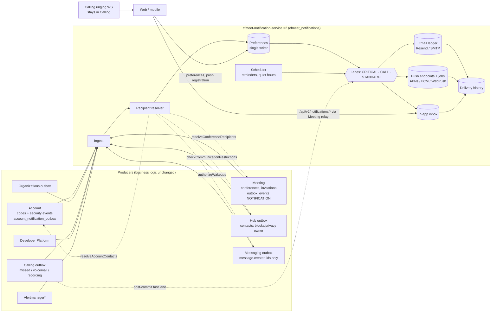

# Document 3 — Current and Target Architecture

The diagrams use Mermaid, which renders on GitHub. Every box in the current-state diagram exists on `main` at `6f3743f`. Its production state is shown in brackets.

---

## 1. Current-state architecture (as built, 2026-11-15)

```mermaid
flowchart LR
  subgraph Clients
    WEB[apps/web<br/>3 WebSockets, polling<br/>no service worker]
    MOB[apps/mobile<br/>polling only<br/>no push SDK]
  end

  subgraph Edge["api.cfmeet.com (host nginx, single VPS)"]
    NGX[nginx]
    GW[API Gateway<br/>DP + Messaging families<br/>WS disabled]
  end

  subgraph Meeting["Meeting Service (+ Account authority) — rtc_db"]
    AUTH[Auth / OTP<br/>Redis codes]
    DEV[Account devices<br/>step-up, notices]
    MN[meeting_notifications<br/>worker 30s]
    LEDGER[(email_deliveries<br/>UNIQUE idempotency_key)]
    EW[Email worker<br/>SMTP active / Resend off]
    RELAY[/api/v2/communications relay/]
    ORGEV[organization_events consumer]
    CRT[Conference realtime WS]
  end

  subgraph Hub["Communications Hub — cfmeet_comm_production_hub"]
    PREF[(notification prefs<br/>conv mute, contact mute)]
    POL[policy/check]
    HOUT[(communication_outbox<br/>dest CALLING,MESSAGING)]
    FEED[/sync, /activity/]
  end

  subgraph Messaging["Messaging — cfmeet_messaging"]
    MOUT[(messaging_outbox_events)]
    PJ[(messaging_push_jobs)]
    PD[Push dispatcher<br/>APNs/FCM/WebPush<br/>provider=none]
    MRT[Realtime WS /v1/realtime]
  end

  subgraph Calling["Calling — cfmeet_calling"]
    RING[Ringing + arbitration<br/>call_answer_claims]
    SIG[Signaling WS<br/>pg_notify bus]
    NOP[NoPushTransport]
    COUT[(calling_outbox_events)]
  end

  subgraph Orgs["Organizations — cfmeet_organizations"]
    OOUT[(organization_outbox)]
  end

  subgraph DP["Developer Platform + worker"]
    WH[(devplat_webhook_*)<br/>active]
    CL[credential lifecycle sweep]
  end

  PA[Platform Access<br/>identity change feed]
  SMTP[(Gmail SMTP<br/>rejected per ops)]
  RESEND[(Resend<br/>not activated)]
  APNS[(APNs/FCM/WebPush<br/>not configured)]
  CUST[(Customer endpoints)]

  WEB --> NGX
  MOB --> NGX
  NGX -->|/api/v1,/api/v2| Meeting
  NGX -->|/v1/environments,/v1/webhooks,/v1/messaging...| GW
  NGX -->|/v1/calling| Calling
  GW --> DP
  GW --> Messaging
  RELAY -->|communications-user.forward| Hub
  AUTH --> LEDGER
  DEV --> LEDGER
  MN -->|preferences.read<br/>GRANT MISSING| PREF
  MN --> LEDGER
  LEDGER --> EW --> SMTP
  EW -.-> RESEND
  MOUT --> PJ --> PD -.-> APNS
  PD -->|policy.check| POL
  RING --> SIG
  RING --> NOP
  COUT --> DP
  OOUT -->|13 event types| ORGEV
  HOUT --> Calling
  HOUT --> Messaging
  CL --> WH --> CUST
  Messaging -->|public events| DP
  Meeting -->|public events| DP
  Calling -.poll.-> PA
  Messaging -.poll.-> PA
```

### 1.1 Production state of each delivery path

| Path | State | Evidence |
|---|---|---|
| Email (any category) | Enqueued durably. Transport is SMTP; delivery **not evidenced** | diagnose 43317264046; certify 43670057279 `EMAIL_PROVIDER=smtp` |
| Meeting notices to account holders | **Very probably failing closed** (missing grant) | `communications_release.py:178`; `notifications.rs:994-996` |
| Device push (all) | **Off** (`MESSAGING_PUSH_PROVIDER=none`); no client registers | certify 43670057279; evidence/06 §1 |
| Call ringing | **Working** (WS, foreground or open tab only) | runs 41580265031, 41581639199 |
| Customer webhooks | **Working** | developer-acceptance 30/30 in certify 43670057279 |
| Org events → Meeting | **Working** (35 delivered, 0 dead) | certify 43670057279 |
| In-app notifications | **Absent** | evidence/06 §3 |
| Operator alerts | **Absent** (except TLS monitor) | `monitoring-alerts.md:3-5` |

---

## 2. Current-state findings (Part 6, items 1–9)

1. **Architectural duplication**
   - **Three durable notification-job models**: `email_deliveries`, `meeting_notifications`, `messaging_push_jobs`.
   - **Five outboxes**: Account, Hub, Organizations, Messaging, Calling. All re-implement lease + `SKIP LOCKED` + 2ⁿ backoff + dead letter.
   - **Two push hooks**: Messaging adapters, and Calling `PushDispatcher` with no transport.
   - **Two device-push stores**: Messaging `messaging_push_registrations`, plus the Hub mirror `push_platform`/`push_registered_at`.
   - Outboxes are correctly per-service (each owns its transaction), so their duplication is **acceptable**. The duplication of the *notification* concerns is what needs consolidating: recipient resolution, preference evaluation, channel selection and delivery history.
2. **Unnecessary coupling**
   - The Meeting Service is the de facto notifier for organizations and developer access, through a synchronous relay side effect and an ops script.
   - The Hub's policy check costs about 6 signed calls per decision (`policy.rs:88-219`), and is only usable by Messaging (`api.rs:315-322`).
   - The Organizations event contract promises a "notification owner" consumer that does not exist (`docs/events/organization-event-contracts.md` §2 vs `outbox.rs:41-59`).
3. **Fragmented history**
   - Each delivery is recorded in a different place: ledger rows, meeting recipient digests, push jobs and webhook attempts.
   - There is no per-user history.
   - The Hub `/activity` timeline covers only calls and meeting invitations.
   - Account `/me/security-events` covers only security.
4. **Conflicting preferences**
   - Contact mute (no expiry) vs conversation mute (`muted_until`).
   - `MENTIONS` is treated as `MUTED`.
   - The org scope is not governed at all.
   - `securityEvents:true` is hard-coded but nothing consumes it.
   - 4 of 7 categories are stored and never read.
5. **Missing delivery monitoring**
   - No alert for email failures, push failures, webhook dead letters or meeting job failures.
   - `notifications::status_counts` is unexposed.
   - Alertmanager is not deployed.
6. **Types with no durable processing**
   - Synchronous invitation emails: no job, no retry beyond the ledger.
   - Best-effort security notices: enqueue failure is lost.
   - The Calling push hook: fire-and-forget, no metric.
   - Contact requests, org role changes, missed calls, voicemail deposit: no processing at all.
7. **Correctly centralized**
   - Email transport (one ledger, exact-once enqueue).
   - Customer webhooks (Developer Platform).
   - Ringing and arbitration (Calling).
   - Preference storage (Hub, single writer).
   - Push payload confidentiality (Messaging DB CHECK + whitelist).
   - Service authentication (`cf-service-auth`).
8. **Migration risks**
   - Duplicate meeting notices during handover.
   - Losing in-flight `meeting_notifications`.
   - Activating push before deciding the registry owner (which would create live handles to migrate).
   - Adding NS to Hub or Organizations destinations needs code and CHECK changes.
   - Per-recipient policy fan-out load.
   - The resource gate on a shared VPS.
9. **Security and privacy boundaries**
   - E2EE plaintext never leaves clients.
   - Push payloads are metadata only.
   - OTP authority is Account.
   - Org membership authority is Organizations.
   - Principal authority is Platform Access.
   - Service tokens are single-audience and receiver-authoritative.

### 2.1 Components that stay outside the notification service (revision 2)

| Component | Why it stays |
|---|---|
| Calling ringing, arbitration, signaling WS, invitation recovery, recording/compliance notices | call control, not notification; latency-critical and transactional (ADR 0008, 0024; brief Part 4.3). **Call push moves** |
| Account code generation, storage, expiry and verification (OTP, reset, device step-up) | token authority (ADR 0057, 0060; brief Part 4.1). **The emails carrying the codes move** (critical lane) |
| Messaging ciphertext, MLS, realtime gateway, read/delivery cursors, membership and device authority | E2EE boundary (ADR 0045-0049, 0060; brief Part 4.4). **Message push moves**; Messaging authorizes each wake-up |
| Conference realtime (waiting room, participant updates) | in-meeting state, not notification |
| Organizations membership/permission writes; Hub blocks and privacy | business authority. The service asks them |
| Developer Platform customer webhooks | separate product (brief Part 4.7). Joining them is owner decision **D-W** |
| Telephony, SMS Gateway, Numbering, Privacy Relay configuration | disabled by owner decision; no dependency is introduced |

**Moving into the notification service:**
- the Meeting email ledger, worker, providers and Resend webhooks;
- all email categories;
- meeting notice jobs and reminder scheduling;
- Messaging push registrations, jobs, adapters and dispatcher;
- the Calling push hook;
- Hub notification preferences (category switches, conversation and contact notification mute);
- every new category, the in-app inbox, delivery history and the operator channel.

---

## 3. Options evaluated

### 3.1 Option B — Unified notification service (**owner-selected, recommended in revision 2**)

One service is the single notification authority. Producers submit notification events through their transactional outboxes. The service owns:
- preferences;
- recipient routing (asking the authorities for membership and identity);
- channels (email, push, in-app, operator, optionally webhook);
- providers and provider callbacks;
- scheduling;
- delivery history.

Old pipelines become clients of the service, are drained, and are then retired.

### 3.2 Option A — Orchestration only (revision 1 recommendation, superseded)

The service would have owned policy, inbox and history while email stayed in the Meeting ledger and push stayed in Messaging. It is lower risk for the email move, but leaves three delivery systems in place. It does not meet the owner's goal of one system.

### 3.3 Option C — Extend the Communications Hub (rejected)

The Hub governs only the personal-communications scope (`packages/communications-policy/src/lib.rs:11-55`). Account, organizations, meetings and developer notifications are outside its authority.

### 3.4 Comparison

| Criterion | Option B (unified) | Option A (orchestration) | How B handles its weak points |
|---|---|---|---|
| Owner goal (one system) | **meets it** | does not | — |
| Reliability of sign-in email | depends on NS availability | stays in Meeting | **critical lane**, 2 replicas, Account transactional outbox (codes are never lost, only delayed), deployed alerting before the move, break-glass fallback to the old Meeting path until Phase 8, moved **last** |
| Duplicate control during migration | per-message routing fence: each message is created in exactly one ledger | dual-enqueue into one ledger | the fence is decided once at enqueue time inside the producer; the old ledger drains only rows created before the fence |
| Code ownership | one team owns all delivery; E2EE checks stay in Messaging via `authorizeWakeups` | split | Messaging authority preserved by an API, not copied |
| Operational complexity | +2 containers, +1 DB; old pipelines retired later (net simpler) | +1 container; three pipelines remain | — |
| Performance | one async hop for every notification; the call push fast path is ≤ 1 s and best-effort | same, minus email | ringing never waits for push |
| Maintainability | one retry, preference, metrics and alerting model | partial | — |
| Cost | €0 infrastructure (fits headroom) | €0 | — |
| Rollback | route new messages back to the old pipeline (configuration); old code kept until Phase 8 | similar | in-flight messages finish in the system they were created in |
| Re-certification | email (Resend acceptance, webhook) and push re-run in the new home | none | uses the existing `email-acceptance` / acceptance journeys, retargeted |

---

## 4. Push and email specifics in the unified design

| Area | Design |
|---|---|
| Push transport | `services/messaging/src/realtime/push_adapters.rs` moves unchanged into the service (or into `packages/push-transport` first, Roadmap N4, so it can be tested before the move). Its tests travel with it |
| Push registry | **Account-device level**, owned by the service (`notif_push_endpoints`). Registered through the new `/api/v2/notifications/devices/{id}/push`. The existing Hub facade and the Messaging customer `registerPush` stay as compatibility facades. This fixes organization/MANAGED push (session devices) and gives Calling's `pushTargetRef` a real target |
| Message wake-ups | Messaging publishes `messaging.message.created` (ids only). The service asks Messaging `authorizeWakeups(conversation, sequence)` for the principals entitled to a wake-up (membership, history window, blocks, device state), at fan-out **and again at dispatch**. Payload stays the 5-key metadata object |
| Call push | Calling `PushDispatcher` → service fast lane (post-commit, ≤ 1 s, no queue). The WebSocket ring path is unchanged |
| Email | the service owns the ledger: a port of `email_deliveries` with improvements (sealed content, keyed recipient digest, suppression list, lease renewal), providers and the Resend Svix webhook. Producers never send email directly again |
| Code emails | Account writes `account_notification_outbox` **in the same transaction** that stores the code, with the code sealed to the service's public key (HPKE). The service decrypts only to render, and erases content at the final state, as the ledger does today |

---

## 5. Target architecture



### 5.1 Ownership boundaries (target)

| Concern | Authority | Notification service role |
|---|---|---|
| Notification preferences (categories, channels, quiet hours, conversation/contact notification mute) | **Notification service** (moved from the Hub; Hub endpoints become facades) | owner |
| Blocks, privacy, contact relationships | Hub | asks (`checkCommunicationRestrictions`, batched) |
| Account identity, email address, locale, time zone, status | Account (Meeting) | asks (`resolveAccountContacts`); keeps addresses only inside email ledger rows (erased per retention) |
| OTP / reset / step-up code generation and verification | Account | renders and delivers sealed codes; never verifies |
| Conference recipients | Meeting | asks (`resolveConferenceRecipients`) at send time |
| Membership / device entitlement for message wake-ups | Messaging | asks (`authorizeWakeups`) |
| Call ring signaling and arbitration | Calling | none (push only) |
| Voicemail owners, recording-authorized principals | Calling | supplied in the outbox fact |
| Org membership | Organizations | consumes events; asks for invitee account (`resolveInvitationInvitee`) |
| Email, push and in-app delivery; provider credentials and callbacks; delivery history | **Notification service** | owner |
| Customer webhooks | Developer Platform (unless D-W) | none / future channel |
| Infrastructure alert evaluation | Prometheus/Alertmanager | optional operator channel for delivery |

### 5.2 Dependency graph and failure isolation

```
Producers ──(transactional outbox, retried)──▶ NS          [NS down ⇒ notifications delayed, never lost; business actions unaffected]
NS ──(read, batched, cached)──▶ Account · Meeting · Messaging · Hub · Organizations · Platform Access feed
Calling ──(post-commit ≤1s best-effort)──▶ NS CALL lane    [ringing never waits]
Clients ──(HTTP via Meeting relay)──▶ NS                   [inbox down ≠ app down]
Sign-in / code verification / call establishment / message send ──✗── never call NS synchronously
```

There are no cycles. Producers call NS only from outbox workers, and NS calls producers only through read APIs.

### 5.3 Event flow examples

**Verification code (critical lane):**
1. Account register commits the user, the code state (hashed, N0-8) and an `account_notification_outbox` row (code sealed to the NS key) in one transaction.
2. The relay posts `account.verification-code.requested` with priority CRITICAL.
3. The service renders it (template `auth.verification`), writes an email ledger row (`idempotency_key = otp:verify:<recipient>:<digest>`, the existing key format) and sends it through Resend.
4. Content is erased at the final state.
5. If NS is down, the row waits in the Account outbox. The break-glass flag `ACCOUNT_EMAIL_FALLBACK=local` lets Account send through the retained legacy ledger until Phase 8.

**Meeting reminder:**
1. Meeting commits a conference schedule change together with an outbox row (`meeting-service.conference.rescheduled`, `cancelKey = conference:<id>`).
2. The service schedules the reminder at `start − lead` in the recipient's time zone context.
3. At fire time it calls `resolveConferenceRecipients` (Meeting authority, protected titles applied by Meeting).
4. It applies preferences and sends email, in-app and push.

**Message wake-up:**
1. Messaging commits the message and outbox row, and publishes `messaging.message.created` (conversation id, sequence, sender principal, scope; no content).
2. The service calls `authorizeWakeups`, which returns the entitled principals.
3. It maps them to account devices and their push endpoints.
4. It rechecks with `authorizeWakeups` at dispatch.
5. It sends the 5-key metadata payload.

---

## 6. Operational alerts (Part 4.8)

| Signal | Where it is evaluated | Where it is delivered |
|---|---|---|
| Health, restarts, OOM, dead letters, backlog, certificate | Prometheus/Alertmanager (deploy the existing rules, D-9) | **optional:** an Alertmanager webhook receiver posts to the notification service operator channel (email to the operator group), so even operator alerts use the one system (Phase 4.7). The TLS monitor's GitHub-issue notice is kept as an independent second path |
| Security incidents (`calling_incidents`, abuse) | owning services + monitoring | same optional operator channel |
| Account-security events | Account | notification service CRITICAL lane (user-facing) |

Monitoring of the notification service itself must **not** depend on the notification service. It keeps the GitHub-issue path and a direct Alertmanager receiver for its own health alerts.

---

## 7. Infrastructure recommendation (Part 13)

### 7.1 Measured headroom

| Measure | Value | Source |
|---|---|---|
| Host | 6 vCPU, 11.7 GiB RAM, 4 GiB swap | `docs/operations/messaging-section-8-delivery.md:292-300` (2026-11-05) |
| MemAvailable (latest) | **5,076 MiB** | certify 43670057279 (2026-11-15) |
| Disk free | **141.1 GiB** | same |
| Release resource gate | `MemAvailable − (new limits + 832 MiB transient) ≥ 1024 MiB` | `infra/calling/production/coordinated_release.py:166-190` |
| Existing limits | Organizations / Numbering / Privacy Relay / SMS / Telephony / API Gateway 192 MiB; Developer Platform 256; DP worker 128; Communications 512; Messaging 1024 | certify 43670057279 |
| Current notification volumes | email ledger "all counts 0" at 2026-11-12; Org events 35 delivered in total; push 0 | diagnose 43317264046; certify 43670057279 |

### 7.2 Sizing

| Resource | Recommendation | Rationale |
|---|---|---|
| Containers | **2 replicas** of `cfmeet-notification-service` (API + workers in each; `SKIP LOCKED` makes them safe to run concurrently) | the critical lane must survive a process crash or a rolling release. Both replicas run on the same VPS, which protects against process failure, not host failure (the whole platform shares that host today) |
| Memory limit | 256 MiB each (expected resident < 96 MiB) | gate: 5,076 − (512 + 832) = 3,732 ≥ 1,024 ✔ |
| CPU | no limit needed; < 1 vCPU combined at current volumes | email rendering and push signing are cheap |
| Database | new `cfmeet_notifications` in the existing `cfmeet-core-db` (Postgres 16), with migrator and runtime roles via `provision-service-database.sh` | same isolation model as the other service databases |
| Queue | Postgres `FOR UPDATE SKIP LOCKED`, separate partial indexes per lane; no Redis or managed queue | volumes are tiny (email ledger "all counts 0" at 2026-11-12) |
| Storage | email ledger rows ≈ 4–20 KB until content erasure, then ≈ 0.5 KB; inbox ≈ 1 KB; total < 2 GiB at 10k users with 90-day retention | 141 GiB free |
| Network | outbound to Resend, the SMTP fallback, Apple, Google and the Web Push endpoints; inbound only through the Meeting relay, the private TLS proxy and the public Resend callback route | — |
| Secrets | Resend key and webhook secret, VAPID key, APNs `.p8`, FCM service account, HPKE private key for sealed codes: all 0400 files moved from Meeting/Messaging mounts | release tooling refuses provider variables until each activation |
| Monitoring | `/metrics` private listener; `notifications.rules.yml`; **Alertmanager deployment with a real receiver is a prerequisite for Phase 4.6** (D-9) | sign-in email must be monitored before it moves |
| Backups | add to `catalog.conf` and the coordinated `backup` operation | consistent |
| Cost | **€0 additional infrastructure.** Provider fees only for owner-activated providers (Resend, Apple Developer Program) | no purchase authorized |

A second server, managed queue or paid queue is **not justified by measurement**. Re-measure at Phase 6.
