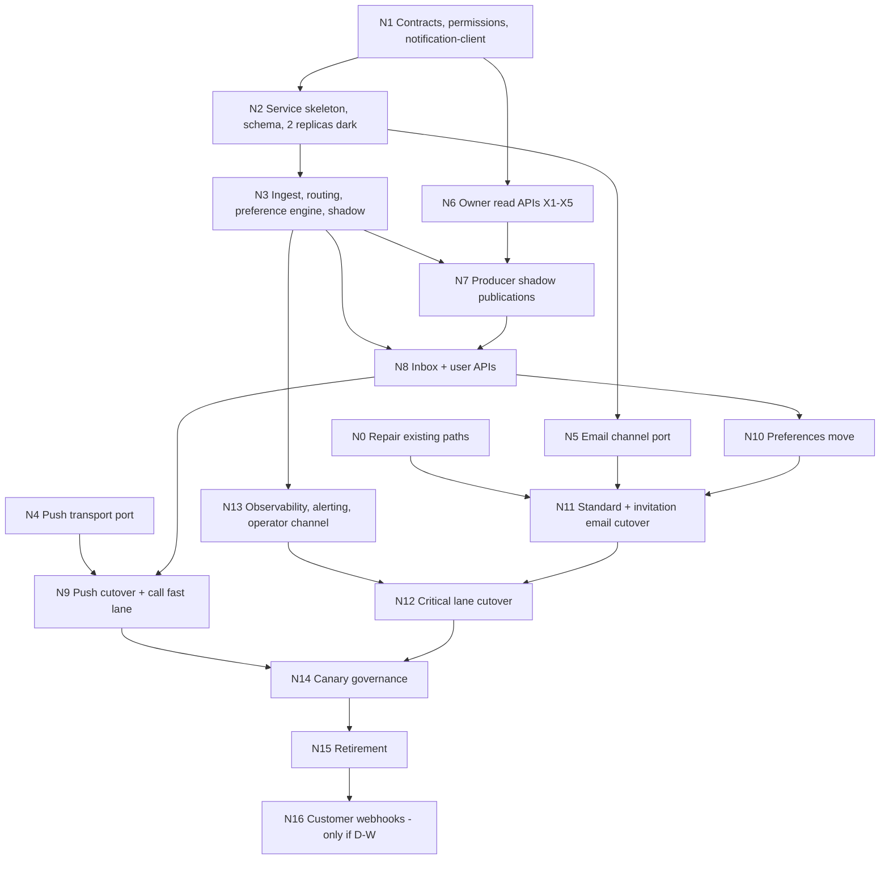

# Document 6 — Implementation Roadmap (revision 2: unified service)

Each section can be assigned on its own **after owner approval**. Dependencies only point backwards. The rows in each section follow Part 15 of the brief (items 1–14). Where a section shares a row value with another, the row says so.

## Dependency graph

**Can start immediately in parallel:** N0, N1, N4.
**Frontend and mobile integrate progressively:**

| Step | After | Work |
|---|---|---|
| FE1 | N1 | generated types |
| FE2 | N8 | inbox UI |
| FE3 | N10 | preference UI on U6/U7 |
| FE4 | N9 | service worker / mobile push SDK on U8/U9 |
| FE5 | N9 | CallKit / ConnectionService |

All UI work needs design approval (D-11).

---

## N0 — Repair the existing paths (owning services)

This section is unchanged from revision 1. Its items are N0-1 … N0-12:
- Hub grant;
- **Resend activation in today's pipeline**;
- poison recipient;
- leases;
- `notify`;
- nginx `/internal`;
- erasure;
- OTP hashing;
- enumeration;
- transactional security notices;
- web logout / `voip`;
- suppression.

**Why N0 still matters when these pipelines will be replaced:**
- users need working codes and notices **now**;
- the shadow comparison needs a correct baseline;
- several fixes are ported into the service (hashing, leases, suppression).

**Definition of done:** each item is released and verified in production.

## N1 — Contracts, permissions, `notification-client`

| # | Field | Content |
|---|---|---|
| 1 | Objective | Freeze every interface (U1–U9, I1–I10, X1–X5, 31 event types, envelope with `sealed`) |
| 2 | Reuse | contract validator, SDK generators, `cf-service-auth` registry |
| 3 | Services | `packages/contracts`, `packages/service-auth`, new `packages/notification-client` |
| 4 | New | notifications HTTP/internal/events contracts; internal additions on Account, Meeting, Messaging, Hub, Organizations; client crate (envelope builder, HPKE sealing, routing-fence helper) |
| 5 | API | contract files only |
| 6 | DB | none |
| 7 | Events/workers | schemas with positive and negative examples |
| 8 | Security | closed `grantable_to`; sensitive flags; HPKE key `kid` rotation in the contract |
| 9 | Tests | validator; conformance; forbidden-key and unsealed-secret examples refused |
| 10 | Prerequisites | owner approval; D-1, D-2 resolved (now: service registry, service fast lane) |
| 11 | Production verification | none |
| 12 | Rollback | revert |
| 13 | Dependencies | — |
| 14 | Done | validator green; FE1 types published |

## N2 — Service skeleton, full schema, 2 replicas (dark)

| # | Field | Content |
|---|---|---|
| 1 | Objective | A healthy, idle unified service in production |
| 2 | Reuse | Organizations/Developer Platform layout; Dockerfile; CI; `provision-service-database.sh`; coordinated release |
| 3 | Services | new service; release tooling |
| 4 | New | crate, migration crate (16 tables), `/health` and `/ready` (per-lane heartbeat), config, nonce table, retention worker |
| 5 | API | none exposed |
| 6 | DB | `cfmeet_notifications`, migration 000001 |
| 7 | Workers | none active |
| 8 | Security | hardened container; private TLS only; secrets as files |
| 9 | Tests | pending-migration refusal; prefix, guard and isolation checks |
| 10 | Prerequisites | N1 |
| 11 | Production verification | certify: 2 replicas healthy, 256 MiB each, gate passed |
| 12 | Rollback | remove the containers |
| 13 | Dependencies | N1 |
| 14 | Done | 24 h `/ready`; zero traffic |

## N3 — Ingest, routing fence, preference engine, shadow

| # | Field | Content |
|---|---|---|
| 1 | Objective | Accept all events, evaluate preferences and precedence, render, and record SHADOW |
| 2 | Reuse | Hub preference/policy logic (ported); Meeting templates (ported) |
| 3 | Services | the service |
| 4 | New | I1, I7, I8, W1, W4, W6, template registry (all categories), `notif_routing` |
| 5 | API | internal |
| 6 | DB | none new |
| 7 | Workers | W1, W4, W6 |
| 8 | Security | HPKE decrypt only in the renderer; sealed fields never logged |
| 9 | Tests | precedence cases 1–12; old-template parity (subject/body hash equal to the Meeting output for the same input); SHADOW makes no provider calls |
| 10 | Prerequisites | N2 |
| 11 | Production verification | a synthetic event shows in I7 |
| 12 | Rollback | revoke producer grants |
| 13 | Dependencies | N2 |
| 14 | Done | all 31 types pass tests |

## N4 — Push transport port

| # | Field | Content |
|---|---|---|
| 1 | Objective | Move APNs, FCM and Web Push adapters (plus APNS_VOIP) out of Messaging with their tests |
| 2 | Reuse | `push_adapters.rs` verbatim |
| 3 | Services | Messaging (path change only), the service |
| 4 | New | `packages/push-transport` (used by Messaging until 4.1, then by the service only) |
| 5–7 | API / DB / workers | none |
| 8 | Security | SSRF allowlist, metadata whitelist and RFC 8291 vectors move unchanged |
| 9 | Tests | existing tests pass unchanged |
| 10 | Prerequisites | none |
| 11 | Production verification | Messaging behaviour identical |
| 12 | Rollback | revert |
| 13 | Dependencies | — |
| 14 | Done | CI green, zero test edits |

## N5 — Email channel port

| # | Field | Content |
|---|---|---|
| 1 | Objective | The service owns an email ledger equivalent to today's, with the known defects fixed |
| 2 | Reuse | `email_delivery.rs` (ledger, worker, `ResendProvider`, `SmtpProvider`, `verify_svix`, `apply_provider_event`) and `tests/email_delivery.rs`, ported |
| 3 | Services | the service |
| 4 | New | `notif_email_messages`, provider events, suppressions; lanes; lease renewal; sealed content; keyed digests; mandatory expiry; provider breaker; public Resend callback route |
| 5 | API | `POST /api/v1/notifications/provider-events/resend`; I9 |
| 6 | DB | tables 10–12 |
| 7 | Workers | W2, W3 (email part) |
| 8 | Security | Svix verification; sealed bodies erased at the final state; never log addresses |
| 9 | Tests | all ported ledger tests (idempotency, retry, permanent failure, expiry, lease recovery, webhook authentication, monotonic status) plus: multi-replica no-duplicate with slow provider; suppression; CRITICAL not starved by a STANDARD backlog |
| 10 | Prerequisites | N2 |
| 11 | Production verification | `email-acceptance` retargeted to the service ledger with Resend (needs D-4 credentials) |
| 12 | Rollback | routing stays OFF; nothing depends on it yet |
| 13 | Dependencies | N2 |
| 14 | Done | acceptance email ACCEPTED and DELIVERED (webhook) from the service |

## N6 — Owner read APIs X1–X5

| # | Field | Content |
|---|---|---|
| 1 | Objective | The service can ask authorities instead of copying them |
| 2 | Reuse | Account profile/device queries; `RECIPIENTS_SQL` and `presented_title`; Messaging `push.rs` entitlement logic; Hub block/privacy checks; Organizations invitation store |
| 3 | Services | Meeting (Account + conferences), Messaging, Hub, Organizations |
| 4 | New | X1–X5 handlers + permissions |
| 5 | API | internal |
| 6 | DB | none |
| 7 | Workers | none |
| 8 | Security | grantable to `cfmeet.notifications` only; batch caps; X1 returns addresses only to this caller; X5 never returns the email |
| 9 | Tests | authorization denials; batch limits; X3 parity with today's `push.rs` decisions (same fixtures from `tests/notification_authorization.rs`) |
| 10 | Prerequisites | N1 |
| 11 | Production verification | certify auth probes (401 without a token) |
| 12 | Rollback | revoke grants |
| 13 | Dependencies | N1 |
| 14 | Done | all five live and unused |

## N7 — Producer shadow publications

| # | Field | Content |
|---|---|---|
| 1 | Objective | Every producer also publishes, in its business transaction, with no user effect |
| 2 | Reuse | each outbox |
| 3 | Services | Account/Meeting, Messaging, Calling, Hub, Organizations, Developer Platform |
| 4 | New | `account_notification_outbox` (Account, new table) + relay; Meeting `outbox_events` channel `NOTIFICATION`; Messaging publication; Calling destination + `CALL_PARTICIPANT_MISSED` (D-10); Hub destination CHECK; Organizations subscriber; Developer Platform publication; all using `notification-client` |
| 5 | API | none public |
| 6 | DB | additive (4 changes) |
| 7 | Workers | producer relays |
| 8 | Security | codes and tokens sealed before the outbox insert |
| 9 | Tests | one event per action in the same transaction; flag off stops it; existing suites unchanged |
| 10 | Prerequisites | N3, N6 |
| 11 | Production verification | Phase 2 exit criteria |
| 12 | Rollback | flags off |
| 13 | Dependencies | N3, N6 |
| 14 | Done | 14-day shadow within thresholds for every category |

## N8 — Inbox and user APIs U1–U5

The rows are as in revision 1, section N7. The relay route, mobile contract routes, authorization-matrix suite and canary acceptance are unchanged.

**Done:** Phase 3 exit criteria are met.

## N9 — Push cutover and call fast lane (Phase 4.1)

| # | Field | Content |
|---|---|---|
| 1 | Objective | All push (messages, calls, other categories, platform tenants) is delivered only by the service |
| 2 | Reuse | N4 adapters; Hub device index |
| 3 | Services | the service, Messaging (stops creating jobs; registration endpoints become facades), Hub (facade), Calling (`NotificationsPushTransport`) |
| 4 | New | U8, U9, I3, W3 push part, `notif_push_endpoints`, the Messaging `message.created` → service path with X3 |
| 5 | API | U8, U9; facades |
| 6 | DB | table 13 |
| 7 | Workers | W3 |
| 8 | Security | sealed handles; `UNIQUE handle_digest`; X3 recheck at dispatch; 5-key payload |
| 9 | Tests | revoked device gets nothing; org/MANAGED device can register; ringing latency unchanged with the service down (fault injection); platform-tenant `registerPush` facade parity |
| 10 | Prerequisites | N4, N8, D-3 (owner provisions credentials) |
| 11 | Production verification | real device per activated platform; backgrounded phone rings (with FE5) |
| 12 | Rollback | Document 5 §9, row 4.1 |
| 13 | Dependencies | N4, N8 |
| 14 | Done | 30 days with no rollback |

## N10 — Preferences move (Phase 4.2)

| # | Field | Content |
|---|---|---|
| 1 | Objective | The service becomes the single preference writer |
| 2 | Reuse | Hub change feed for catch-up |
| 3 | Services | the service, Hub (facade) |
| 4 | New | U6, U7; copy + catch-up job; 7-day change log for write-back |
| 5 | API | U6, U7; Hub endpoints become facades |
| 6 | DB | tables 14–16 |
| 7 | Workers | one-off copy |
| 8 | Security | own preferences only; version concurrency |
| 9 | Tests | copy parity; facade parity with old clients (7 booleans); freeze < 60 s; rollback write-back |
| 10 | Prerequisites | N8 |
| 11 | Production verification | `communications-verify` preference checks still pass through the facade |
| 12 | Rollback | Document 5 §9, row 4.2 |
| 13 | Dependencies | N8 |
| 14 | Done | counts and versions equal; 30 days stable |

## N11 — Standard and invitation email cutover (Phases 4.3 and 4.4)

| # | Field | Content |
|---|---|---|
| 1 | Objective | Meeting, developer and invitation emails are sent only by the service |
| 2 | Reuse | N5; X2 |
| 3 | Services | the service, Meeting, Developer Platform, ops script |
| 4 | New | scheduler for reminders (port of `enqueue_due_reminders` and the "still true" checks); Meeting producers routed by the fence |
| 5 | API | Resend webhook endpoint added (both endpoints active during the drain) |
| 6 | DB | — |
| 7 | Workers | W3, W4 |
| 8 | Security | tokens sealed; never in the inbox |
| 9 | Tests | fence boundary; drain; reminder after reschedule and after cancel; protected titles; `emailDelivery` semantics kept |
| 10 | Prerequisites | N0-1, N0-2, N0-3; N5 production acceptance; N10 |
| 11 | Production verification | acceptance meeting journey: one email per recipient, from the service ledger |
| 12 | Rollback | per-category fence back |
| 13 | Dependencies | N0, N5, N10 |
| 14 | Done | 30 days per category |

## N12 — Critical lane cutover (Phases 4.5 and 4.6)

| # | Field | Content |
|---|---|---|
| 1 | Objective | Security notices, then sign-in/verification/reset/step-up code emails, go through the service |
| 2 | Reuse | `account_notification_outbox` (N7); retained old path as break-glass |
| 3 | Services | Account (Meeting), the service |
| 4 | New | Account routing switch per category; `ACCOUNT_EMAIL_FALLBACK=local` |
| 5 | API | none |
| 6 | DB | — |
| 7 | Workers | W2 |
| 8 | Security | HPKE-sealed codes; erased at the final state; Account remains the verifier |
| 9 | Tests | OTP journey end-to-end through the service (port of `otp_journey_from_registration_to_session`); service-down → codes delayed, not lost; break-glass switch; the CRITICAL lane under a STANDARD flood |
| 10 | Prerequisites | N11 30 days stable; **N13 alerting deployed (D-9)**; CRITICAL shadow p95 ≤ Q17 + 5 s |
| 11 | Production verification | `email-acceptance confirm=otp` through the service at every canary step |
| 12 | Rollback | break-glass, then fence back |
| 13 | Dependencies | N11, N13 |
| 14 | Done | 60 days at 100 % with zero fallback use |

## N13 — Observability, alerting, operator channel

The base is as in revision 1, section N12, plus:
- **deploy Prometheus/Alertmanager with real receivers (D-9)**: a prerequisite for N12;
- I4–I9;
- certify checks (routing agreement, lane backlog);
- the optional I10 operator channel (Phase 4.7), with the service's own health alerts on a direct path.

## N14 — Canary governance

The canary percentages are acceptance accounts → 10 % → 50 % → 100 %. Gates are in Document 7 §5. Single routing is certified.

## N15 — Retirement

Follows Document 5 §10. Each retirement is a separate reviewed change, made only with the evidence listed there.

## N16 — Customer webhooks (only if D-W)

This needs a separate audit addendum. It is not before 90 days of stable user channels.

---

## Programme definition of done

1. Every category and channel in the unified service is at 100 % for at least 30 days. The CRITICAL lane is at 60 days, with zero break-glass use.
2. Old pipelines are retired per Document 5 §10.
3. All Document 7 §5 gates pass in production, including real-credential checks for every activated provider.
4. Document 8 S-1 … S-13 are closed.
5. No business action (sign-in, call, message, org change) has any synchronous dependency on the service. Fault-injection test R-12 passes in production.
