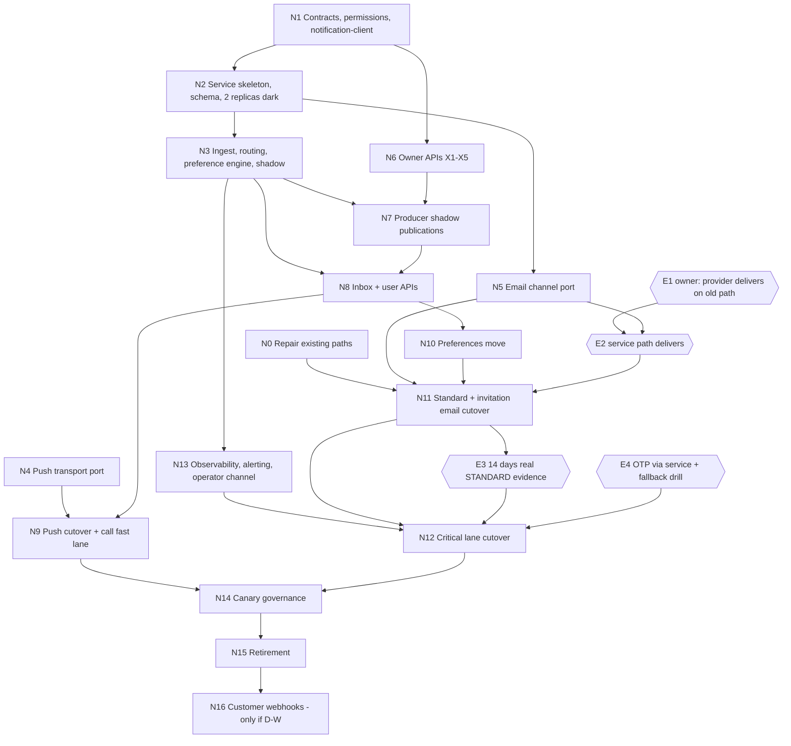

# Document 6 — Implementation Roadmap (revision 2: unified service)

Each section can be assigned on its own **after owner approval**. Dependencies only point backwards. The rows in each section follow Part 15 of the brief (items 1–14). Where a section shares a row value with another, the row says so.

**Corrected 2026-11-15 (pre-coding review):**
- Row 14 now separates **engineering completion** (code merged, tests green, deployed, functionally verified in production) from **operational acceptance** (observation windows of 30 or 60 days, plus gates). An engineer can finish a section; only time and evidence can accept it. See §Milestones.
- Email-provider activation is a separate owner **E-track**. It is never an engineering prerequisite (Document 4 §14).
- The routing fence protocol (Document 4 §9) and the verified fallback (Document 4 §10.4) are assigned to N7 and N12.

## Dependency graph

**Can start immediately in parallel:** N0, N1, N4, and the owner's E-track step E1.

**E-track** (owner, provider activation on the existing Meeting adapters; Document 4 §14.3). E1 → E2 → E3 → E4 are **gates for moving email categories**, not for building anything. N1–N10 and N13 never wait for them.
**Frontend and mobile integrate progressively:**

| Step | After | Work |
|---|---|---|
| FE1 | N1 | generated types |
| FE2 | N8 | inbox UI |
| FE3 | N10 | preference UI on U6/U7 |
| FE4 | N9 | service worker / mobile push SDK on U8/U9 |
| FE5 | N9 | CallKit / ConnectionService |

All UI work needs design approval (D-11).

---

## N0 — Repair the existing paths (owning services)

| # | Field | Content |
|---|---|---|
| 1 | Objective | Make today's notifications work and remove the security defects before anything moves. Users need working codes and notices now; the shadow comparison needs a correct baseline; several fixes (OTP hashing, lease renewal, suppression) are ported into the unified service |
| 2 | Reuse | All existing code and tooling (`activate-resend-email`, `email-acceptance`, release tests) |
| 3 | Services affected | Meeting, Messaging, Hub release tooling, nginx config, apps/web, apps/mobile |
| 4 | New components | none |
| 5 | API changes | none publicly. `verify-reset-token` returns a uniform answer (status semantics kept for the valid case) |
| 6 | Database changes | additive. Retention indexes / purge for `messaging_push_jobs`. No destructive change |
| 7 | Events and workers | email worker and push dispatcher lease renewal; meeting worker poison-recipient handling |
| 8 | Security | see the items below |
| 9 | Tests | one regression test per item (listed below) |
| 10 | Prerequisites | Phase 0 queries Q3, Q14 and Q15 to confirm S-1 and S-3 before changing them |
| 11 | Production verification | Q3 shows SENT notices for account holders (after N0-1); Q15 shows the internal routes are not reachable publicly; one regression check per item |
| 12 | Rollback | each item is a separate release; standard `rollback` |
| 13 | Dependencies | none |
| 14 | Definition of done | **Engineering:** every engineering item below merged, released and verified in production; Document 8 status → "repaired". **Operational acceptance:** none required beyond verification. N0-2 is tracked in the E-track |

The items:

| Item | Change | Evidence | Regression test |
|---|---|---|---|
| N0-1 | Grant `communications-preferences.read` to `cfmeet.meeting-service` in `communications_release.py` (the Hub bundle builder) and in the coordinated `GRANTS` | S-1 | release test asserts the grant is present; production `organization-acceptance`-style check sends a notice to a test account |
| N0-2 | **Moved to the E-track (E1, owner).** The owner makes the existing Meeting adapters deliver: Resend (`activate-resend-email`) or a working SMTP account. Proven by `email-acceptance confirm=otp` with real delivery evidence. No engineering dependency | S-2 | the existing `test_email_operations.py` |
| N0-3 | `notifications::deliver`: `BadRequest` from `enqueue` marks that recipient `INVALID_ADDRESS` and continues | S-11 | poison address in `RECIPIENTS_SQL` → others still sent |
| N0-4 | Email worker and push dispatcher: per-item lease renewal, or batch ≤ lease / (timeout × 3) | S-8 | two workers + slow fake provider → 0 duplicates |
| N0-5 | Messaging: honour `notify=false` only for delegated/migration callers (`messaging-application.delegate` / import), never for client tokens | S-4 | client token `notify:false` → the push job is still created |
| N0-6 | nginx: `location ^~ /internal/ { return 404; }` on the public server block (verify first, Q15) | S-3 | public certify probe `/internal/operations/email/deliveries/<uuid>` → nginx 404 |
| N0-7 | `PRINCIPAL_ERASURE` deletes push registrations and jobs for the principal | S-7 | erasure test asserts 0 rows |
| N0-8 | OTP: store SHA-256(code + per-key salt), constant-time compare, key by hash of email | S-5 | existing OTP journey test + Redis key inspection |
| N0-9 | `verify-reset-token`: uniform response and timing | S-6 | enumeration test |
| N0-10 | Security notices (password changed, new device) enqueued in the same transaction (as step-up already is) | S-9 | failure injection → notice still queued |
| N0-11 | Web logout revokes the browser's Calling endpoint; mobile removes `voip` from `UIBackgroundModes` until CallKit exists | S-10, mobile risk | web unit test; app config review |
| N0-12 | Bounce/complaint suppression: refuse new non-security sends to a `recipient_hash` with COMPLAINED, or BOUNCED twice | S-12 | webhook → suppression → enqueue refused with `SUPPRESSED` |

---

## N1 — Contracts, permissions, `notification-client`

| # | Field | Content |
|---|---|---|
| 1 | Objective | Freeze every interface listed in the canonical register (README §Canonical register) |
| 2 | Reuse | contract validator, SDK generators, `cf-service-auth` registry |
| 3 | Services | `packages/contracts`, `packages/service-auth`, new `packages/notification-client` |
| 4 | New | notifications HTTP/internal/events contracts (U1–U9, provider callback, I1–I12, X1–X7, 31 event types + control event, envelope with `route` and `sealed`); client crate (envelope builder, HPKE sealing, route-decision helper implementing Document 4 §9.3) |
| 5 | API | contract files only |
| 6 | DB | none |
| 7 | Events/workers | schemas with positive and negative examples |
| 8 | Security | closed `grantable_to`; sensitive flags; HPKE key `kid` rotation in the contract |
| 9 | Tests | validator; conformance; forbidden-key and unsealed-secret examples refused |
| 10 | Prerequisites | owner approval; D-1, D-2 resolved (now: service registry, service fast lane) |
| 11 | Production verification | none |
| 12 | Rollback | revert |
| 13 | Dependencies | — |
| 14 | Definition of done | **Engineering:** validator green; FE1 types published. **Operational acceptance:** n/a |

## N2 — Service skeleton, full schema, 2 replicas (dark)

| # | Field | Content |
|---|---|---|
| 1 | Objective | A healthy, idle unified service in production |
| 2 | Reuse | Organizations/Developer Platform layout; Dockerfile; CI; `provision-service-database.sh`; coordinated release |
| 3 | Services | new service; release tooling |
| 4 | New | crate, migration crate (17 tables), `/health` and `/ready` (per-lane heartbeat, `routingProtocol`), config, nonce table, retention worker |
| 5 | API | none exposed |
| 6 | DB | `cfmeet_notifications`, migration 000001 |
| 7 | Workers | none active |
| 8 | Security | hardened container; private TLS only; secrets as files |
| 9 | Tests | pending-migration refusal; prefix, guard and isolation checks |
| 10 | Prerequisites | N1 |
| 11 | Production verification | certify: 2 replicas healthy, 256 MiB each, gate passed |
| 12 | Rollback | remove the containers |
| 13 | Dependencies | N1 |
| 14 | Definition of done | **Engineering:** deployed dark, both replicas `/ready`. **Operational acceptance:** 24 h stable with zero traffic |

## N3 — Ingest, routing fence, preference engine, shadow

| # | Field | Content |
|---|---|---|
| 1 | Objective | Accept all events, evaluate preferences and precedence, render, and record SHADOW |
| 2 | Reuse | Hub preference/policy logic (ported); Meeting templates (ported) |
| 3 | Services | the service |
| 4 | New | I1 (with `route` validation, HELD state, `dryRun` probe), I7, I8 (route audit digests), W1, W4, W6, template registry (all categories), `notif_routing` |
| 5 | API | internal |
| 6 | DB | none new |
| 7 | Workers | W1, W4, W6 |
| 8 | Security | HPKE decrypt only in the renderer; sealed fields never logged |
| 9 | Tests | precedence cases 1–12; old-template parity (subject/body hash equal to the Meeting output for the same input); SHADOW makes no provider calls |
| 10 | Prerequisites | N2 |
| 11 | Production verification | a synthetic event shows in I7 |
| 12 | Rollback | revoke producer grants |
| 13 | Dependencies | N2 |
| 14 | Definition of done | **Engineering:** all 31 types and the control event pass tests; non-`NEW` routes rejected; HELD path tested. **Operational acceptance:** n/a (no traffic until N7) |

## N4 — Push transport port

| # | Field | Content |
|---|---|---|
| 1 | Objective | Move APNs, FCM and Web Push adapters (plus APNS_VOIP) out of Messaging with their tests |
| 2 | Reuse | `push_adapters.rs` verbatim |
| 3 | Services | Messaging (path change only), the service |
| 4 | New | `packages/push-transport` (used by Messaging until 4.1, then by the service only) |
| 5–7 | API / DB / workers | none |
| 8 | Security | SSRF allowlist, metadata whitelist and RFC 8291 vectors move unchanged |
| 9 | Tests | existing tests pass unchanged |
| 10 | Prerequisites | none |
| 11 | Production verification | Messaging behaviour identical |
| 12 | Rollback | revert |
| 13 | Dependencies | — |
| 14 | Definition of done | **Engineering:** CI green, zero test edits. **Operational acceptance:** n/a |

## N5 — Email channel port

| # | Field | Content |
|---|---|---|
| 1 | Objective | The service owns an email ledger equivalent to today's, with the known defects fixed |
| 2 | Reuse | `email_delivery.rs` (ledger, worker, `ResendProvider`, `SmtpProvider`, `verify_svix`, `apply_provider_event`) and `tests/email_delivery.rs`, ported |
| 3 | Services | the service |
| 4 | New | **port of the existing adapter architecture** (`EmailProvider` trait, `ResendProvider`, `SmtpProvider`, `RecordingProvider`, `none`; same selection rules under `NOTIFICATIONS_EMAIL_PROVIDER`, Document 4 §14.1); `notif_email_messages` (deterministic UUIDv5 IDs), provider events, suppressions; lanes; lease renewal; sealed content; keyed digests; mandatory expiry; provider breaker; public Resend callback route. **No new provider dependency** |
| 5 | API | `POST /api/v1/notifications/provider-events/resend`; I9 |
| 6 | DB | tables 10–12 |
| 7 | Workers | W2, W3 (email part) |
| 8 | Security | Svix verification; sealed bodies erased at the final state; never log addresses |
| 9 | Tests | all ported ledger tests (idempotency, retry, permanent failure, expiry, lease recovery, webhook authentication, monotonic status) plus: multi-replica no-duplicate with slow provider; suppression; CRITICAL not starved by a STANDARD backlog |
| 10 | Prerequisites | N2 |
| 11 | Production verification | dark deployment with `NOTIFICATIONS_EMAIL_PROVIDER=none` (mail stays queued and expires); no provider credentials needed. Real delivery is **gate E2** (E-track), not part of this section |
| 12 | Rollback | routing stays OFF; nothing depends on it yet |
| 13 | Dependencies | N2 |
| 14 | Definition of done | **Engineering:** all ported ledger tests and new tests pass with `RecordingProvider`; deployed dark. **Operational acceptance:** n/a. Delivery evidence belongs to E2 |

## N6 — Owner read APIs X1–X5 (X6–X7 are built in N12)

| # | Field | Content |
|---|---|---|
| 1 | Objective | The service can ask authorities instead of copying them |
| 2 | Reuse | Account profile/device queries; `RECIPIENTS_SQL` and `presented_title`; Messaging `push.rs` entitlement logic; Hub block/privacy checks; Organizations invitation store |
| 3 | Services | Meeting (Account + conferences), Messaging, Hub, Organizations |
| 4 | New | X1–X5 handlers + permissions |
| 5 | API | internal |
| 6 | DB | none |
| 7 | Workers | none |
| 8 | Security | grantable to `cfmeet.notifications` only; batch caps; X1 returns addresses only to this caller; X5 never returns the email |
| 9 | Tests | authorization denials; batch limits; X3 parity with today's `push.rs` decisions (same fixtures from `tests/notification_authorization.rs`) |
| 10 | Prerequisites | N1 |
| 11 | Production verification | certify auth probes (401 without a token) |
| 12 | Rollback | revoke grants |
| 13 | Dependencies | N1 |
| 14 | Definition of done | **Engineering:** X1–X5 live and unused, denials verified in production. **Operational acceptance:** n/a |

## N7 — Producer shadow publications

| # | Field | Content |
|---|---|---|
| 1 | Objective | Every producer also publishes, in its business transaction, with no user effect |
| 2 | Reuse | each outbox |
| 3 | Services | Account/Meeting, Messaging, Calling, Hub, Organizations, Developer Platform |
| 4 | New | **routing fence protocol v1** (Document 4 §9): `notification_routing_state` + `notification_route_decisions` in the Meeting and Messaging databases, guard triggers on `email_deliveries` / `meeting_notifications` / `messaging_push_jobs` (inert in `LEGACY_ONLY`), deterministic keys for today's random-key categories, `routingProtocol` in `/ready`, release-tooling **rollback floor** and activation preconditions, hourly audit; `account_notification_outbox` (Account, new table, two-recipient sealing) + relay PW1; Meeting `outbox_events` channel `NOTIFICATION`; Messaging publication; Calling destination + `CALL_PARTICIPANT_MISSED` (D-10); Hub destination CHECK; Organizations subscriber; Developer Platform publication; all using `notification-client` |
| 5 | API | none public |
| 6 | DB | additive (4 changes) |
| 7 | Workers | producer relays |
| 8 | Security | codes and tokens sealed before the outbox insert |
| 9 | Tests | one event per action in the same transaction; flag off stops it; existing suites unchanged; **fence tests M-10 … M-17** (Document 7 §4) |
| 10 | Prerequisites | N3, N6 |
| 11 | Production verification | Phase 2 exit criteria |
| 12 | Rollback | flags off |
| 13 | Dependencies | N3, N6 |
| 14 | Definition of done | **Engineering:** all publications deployed in SHADOW; fence tests green; guard triggers installed and inert. **Operational acceptance:** 14-day shadow within thresholds for every category (Phase 2 exit) |

## N8 — Inbox and user APIs U1–U5

| # | Field | Content |
|---|---|---|
| 1 | Objective | Users see an inbox for categories that have no channel today (Phase 3) |
| 2 | Reuse | the Meeting `/api/v2/communications` relay pattern, `VerifiedAccount` |
| 3 | Services affected | the service, Meeting (relay route + OpenAPI), web, mobile |
| 4 | New components | U1–U5; I2; inbox writer in W1; `notifications.inbox.changed` (internal) |
| 5 | API changes | U1–U5 (NEW); `meeting-service.json` gains the routes (mobile contract) |
| 6 | Database changes | none new (table 5 from N2) |
| 7 | Events and workers | W1 writes items; W5 retention |
| 8 | Security | own items only (404 for foreign IDs); closed `action.kind`; rate limits; authorization-matrix suite for U1–U5 |
| 9 | Tests | read/unread/dismiss sync across two sessions; grouping; silent items excluded from the count; ETag 304; pagination stability |
| 10 | Prerequisites | N3, N7 |
| 11 | Production verification | canary accounts receive a contact-request item end-to-end (real Hub action → item visible) |
| 12 | Rollback | relay route off; IN_APP routing OFF |
| 13 | Dependencies | N3, N7 |
| 14 | Definition of done | **Engineering:** U1–U5 live behind the relay; canary item verified. **Operational acceptance:** Phase 3 exit (Document 7 §5 A3); FE2 integrated behind a flag |

## N9 — Push cutover and call fast lane (Phase 4.1)

| # | Field | Content |
|---|---|---|
| 1 | Objective | All push (messages, calls, other categories, platform tenants) is delivered only by the service |
| 2 | Reuse | N4 adapters; Hub device index |
| 3 | Services | the service, Messaging (stops creating jobs; registration endpoints become facades), Hub (facade), Calling (`NotificationsPushTransport`) |
| 4 | New | U8, U9, I3, W3 push part, `notif_push_endpoints`, the Messaging `message.created` → service path with X3 |
| 5 | API | U8, U9; facades |
| 6 | DB | table 13 |
| 7 | Workers | W3 |
| 8 | Security | sealed handles; `UNIQUE handle_digest`; X3 recheck at dispatch; 5-key payload |
| 9 | Tests | revoked device gets nothing; org/MANAGED device can register; ringing latency unchanged with the service down (fault injection); platform-tenant `registerPush` facade parity |
| 10 | Prerequisites | N4, N7 (Messaging decisions), N8; D-3 (owner provisions credentials); D-1b copy path if Web Push is activated in Messaging first |
| 11 | Production verification | real device per activated platform; backgrounded phone rings (with FE5) |
| 12 | Rollback | Document 5 §9, row 4.1 |
| 13 | Dependencies | N4, N8 |
| 14 | Definition of done | **Engineering:** U8/U9, I3, facades and Messaging decisions deployed; real-device check per activated platform. **Operational acceptance:** 30 days at 100 % with no rollback |

## N10 — Preferences move (Phase 4.2)

| # | Field | Content |
|---|---|---|
| 1 | Objective | The service becomes the single preference writer |
| 2 | Reuse | Hub change feed for catch-up |
| 3 | Services | the service, Hub (facade) |
| 4 | New | U6, U7; copy + catch-up job; 7-day change log for write-back |
| 5 | API | U6, U7; Hub endpoints become facades |
| 6 | DB | tables 14–16 |
| 7 | Workers | one-off copy |
| 8 | Security | own preferences only; version concurrency |
| 9 | Tests | copy parity; facade parity with old clients (7 booleans); freeze < 60 s; rollback write-back |
| 10 | Prerequisites | N8 |
| 11 | Production verification | `communications-verify` preference checks still pass through the facade |
| 12 | Rollback | Document 5 §9, row 4.2 |
| 13 | Dependencies | N8 |
| 14 | Definition of done | **Engineering:** copy + catch-up + facade switch done; counts and versions equal. **Operational acceptance:** 30 days stable |

## N11 — Standard and invitation email cutover (Phases 4.3 and 4.4)

| # | Field | Content |
|---|---|---|
| 1 | Objective | Meeting, developer and invitation emails are sent only by the service |
| 2 | Reuse | N5; X2 |
| 3 | Services | the service, Meeting, Developer Platform, ops script |
| 4 | New | Meeting producers routed by the fence protocol (4.3a: the old scan stays the reminder trigger); scheduler for reminders (port of `enqueue_due_reminders` and the "still true" checks) activated at takeover boundary `B` (4.3b, Document 4 §9.9) |
| 5 | API | Resend webhook endpoint added (both endpoints active during the drain) |
| 6 | DB | — |
| 7 | Workers | W3, W4 |
| 8 | Security | tokens sealed; never in the inbox |
| 9 | Tests | fence boundary; drain; reminder after reschedule and after cancel; protected titles; `emailDelivery` semantics kept |
| 10 | Prerequisites | N0-1, N0-3; N5; N7; N10; **gates E1 and E2** (E-track) |
| 11 | Production verification | acceptance meeting journey: one email per recipient, from the service ledger |
| 12 | Rollback | per-category fence back |
| 13 | Dependencies | N0, N5, N10 |
| 14 | Definition of done | **Engineering:** routing and scheduler shipped; first canary category verified end-to-end. **Operational acceptance:** 30 days at 100 % per category; then gate E3 (≥ 14 days real STANDARD delivery evidence) |

## N12 — Critical lane cutover (Phases 4.5 and 4.6)

| # | Field | Content |
|---|---|---|
| 1 | Objective | Security notices, then sign-in/verification/reset/step-up code emails, go through the service |
| 2 | Reuse | `account_notification_outbox` and route decisions (N7); retained old Meeting email path as the fallback |
| 3 | Services | Account (Meeting), the service |
| 4 | New | **X6 `claimCriticalSendLeases` and X7 `completeCriticalSends`** (Account); W2 lease handling; **AUTO failover** in relay PW1 and **FORCED** mode in `notification_routing_state` (no restart); fallback drill (`email-acceptance confirm=fallback`); fallback readiness certify checks (Document 4 §10.4) |
| 5 | API | none |
| 6 | DB | — |
| 7 | Workers | W2 |
| 8 | Security | HPKE-sealed codes; erased at the final state; Account remains the verifier |
| 9 | Tests | OTP journey end-to-end through the service (port of `otp_journey_from_registration_to_session`); AUTO failover with both replicas stopped and with the service DB unavailable (R-21, R-22); FORCED mode without restart (R-19); fallback readiness (R-23); lease protocol (M-17, ST-20); the CRITICAL lane under a STANDARD flood (R-17) |
| 10 | Prerequisites | N11 operationally accepted; **gates E3 and E4**; **N13 alerting deployed (D-9)**; Q17 MEASURED and CRITICAL shadow p95 ≤ `B(Q17)` + 5 s |
| 11 | Production verification | `email-acceptance confirm=otp` through the service at every canary step |
| 12 | Rollback | `critical_fallback = FORCED`, then category → `FENCED_OLD` (Document 5 §9) |
| 13 | Dependencies | N11, N13 |
| 14 | Definition of done | **Engineering:** leases, AUTO/FORCED fallback and drill shipped; fallback verified in production (both replicas stopped in a maintenance window). **Operational acceptance:** 60 days at 100 % with zero AUTO/FORCED use |

## N13 — Observability, alerting, operator channel

| # | Field | Content |
|---|---|---|
| 1 | Objective | Operators can see, diagnose and replay without database access, and **alerting is live before the critical lane moves** |
| 2 | Reuse | rule CI (`check_alert_rules.py`, promtool, amtool), certify framework, existing `meeting-service.rules.yml` / `messaging.rules.yml` |
| 3 | Services affected | the service, `infra/monitoring`, coordinated-release certify |
| 4 | New components | I4–I12; `notifications.rules.yml` (per-lane backlog, CRITICAL age > 60 s, failure rate, breaker, replica down); **Prometheus + Alertmanager deployed with real receivers (D-9)**; certify checks "routing agreement" and "lane backlog"; runbooks (outage → AUTO/FORCED fallback, replay, credential and HPKE key rotation); optional I10 operator channel (Phase 4.7, D-15) |
| 5 | API changes | internal I4–I12 |
| 6 | Database changes | none |
| 7 | Events and workers | — |
| 8 | Security | operator identity audit; PII-free responses; the service's own health alerts use a direct path (not the service) |
| 9 | Tests | rule unit tests; certify offline tests; a fired test alert reaches a person through the configured receiver |
| 10 | Prerequisites | N3; D-9 |
| 11 | Production verification | a synthetic alert is delivered; certify output includes routing and lane backlog |
| 12 | Rollback | receivers can be removed; rules are inert |
| 13 | Dependencies | N3 |
| 14 | Definition of done | **Engineering:** runbooks reviewed; alert delivery proven in production; certify green. **Operational acceptance:** n/a (prerequisite for N12) |

## N14 — Canary governance

The canary percentages are acceptance accounts → 10 % → 50 % → 100 %. Gates are in Document 7 §5. Single routing is certified.

## N15 — Retirement

Follows Document 5 §10. Each retirement is a separate reviewed change, made only with the evidence listed there.

## N16 — Customer webhooks (only if D-W)

This needs a separate audit addendum. It is not before 90 days of stable user channels.

---

## Milestones: engineering completion vs operational acceptance

| Milestone | Meaning | Achieved when | Who can achieve it |
|---|---|---|---|
| **M1 ENGINEERING_COMPLETE** | everything is built, tested, deployed and functionally verified in production | the row-14 *Engineering* part of N1–N13 is done: every channel routable through the fence; fallback verified in production; alerting live; all Document 7 functional, reliability, security and migration tests green; real-device and real-delivery checks run once for each activated provider | engineering (plus the owner for E1/E2 credentials) |
| **M2 OPERATIONALLY_ACCEPTED** (per category) | the category has run on the service under real traffic long enough | push, preferences and STANDARD email: 30 days at 100 % with no rollback and every Document 7 §5 gate within its baseline bound. CRITICAL lane: 60 days at 100 % with zero AUTO/FORCED fallback use. **Baseline gates require the matching Q1–Q18 to be MEASURED** | time + evidence; never by declaration |
| **M3 PROGRAMME_ACCEPTED** | every category is M2 | all categories at M2; Document 8 S-1 … S-13 and S-19 closed; R-12 passes in production (no business action depends synchronously on the service) | owner sign-off |
| **M4 LEGACY_RETIRED** | old pipelines removed | Document 5 §10 evidence per item: 90 days of CRITICAL with zero fallback use before the Meeting email path is removed | owner sign-off per retirement |

Engineering status is reported as M1. A 30- or 60-day window never extends an engineering section; it only delays M2/M3/M4.
