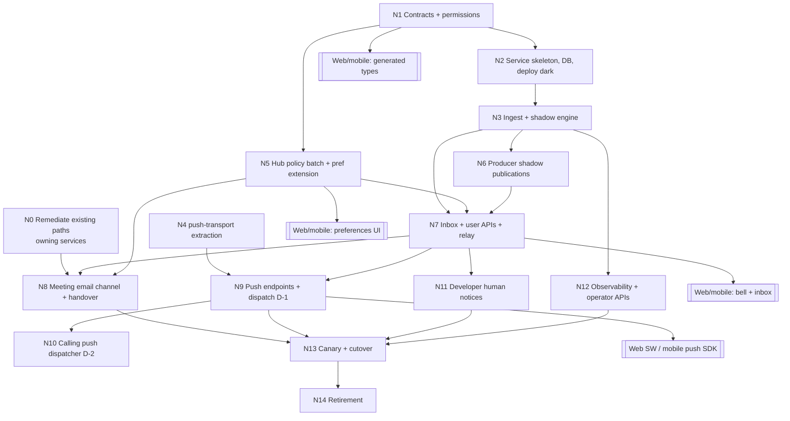

# Document 6 — Implementation Roadmap

Each numbered section can be assigned to the backend agent on its own, **after owner approval**. The sections are ordered so that every dependency points backwards. Frontend and mobile can integrate each approved API as soon as its section is done.

The row headings used in each section follow Part 15 of the brief, items 1–14.

---

## Dependency graph

**N0 and N4 have no dependencies.** They can start immediately in parallel. N0 is the highest-value work in the whole programme.

---

## N0 — Remediate existing notification paths (owning services)

| # | Field | Content |
|---|---|---|
| 1 | Objective | Make today's notifications work and remove the security defects before anything is centralized |
| 2 | Reuse | All existing code and tooling (`activate-resend-email`, `email-acceptance`, release tests) |
| 3 | Services affected | Meeting, Messaging, Hub release tooling, nginx config, apps/web, apps/mobile |
| 4 | New components | none |
| 5 | API changes | none publicly. `verify-reset-token` returns a uniform answer (status semantics kept for the valid case) |
| 6 | Database changes | additive. Retention indexes / purge for `messaging_push_jobs`. No destructive change |
| 7 | Events and workers | email worker and push dispatcher lease renewal; meeting worker poison-recipient handling |
| 8 | Security | see the items below |
| 9 | Tests | one regression test per item (listed below) |
| 10 | Prerequisites | Phase 0 queries Q3, Q14 and Q15 to confirm S-1 and S-3 before changing them |
| 11 | Production verification | `email-acceptance confirm=otp` PASS; Q3 shows SENT notices for account holders; Q15 shows the internal routes are not reachable publicly |
| 12 | Rollback | each item is a separate release; standard `rollback` |
| 13 | Dependencies | none |
| 14 | Definition of done | every item below has merged, been released and been verified in production; Document 8 status → "repaired" |

The items:

| Item | Change | Evidence | Regression test |
|---|---|---|---|
| N0-1 | Grant `communications-preferences.read` to `cfmeet.meeting-service` in `communications_release.py` (the Hub bundle builder) and in the coordinated `GRANTS` | S-1 | release test asserts the grant is present; production `organization-acceptance`-style check sends a notice to a test account |
| N0-2 | **Owner** completes the Resend setup → `activate-resend-email` → `email-acceptance confirm=otp` (existing tooling; no code) | S-2 | the existing `test_email_operations.py` |
| N0-3 | `notifications::deliver`: `BadRequest` from `enqueue` marks that recipient `INVALID_ADDRESS` and continues | S-11 | poison address in `RECIPIENTS_SQL` → others still sent |
| N0-4 | Email worker and push dispatcher: per-item lease renewal, or batch ≤ lease / (timeout × 3) | S-8 | two workers + slow fake provider → 0 duplicates |
| N0-5 | Messaging: honour `notify=false` only for delegated/migration callers (`messaging-application.delegate` / import), never for client tokens | S-4 | client token `notify:false` → the push job is still created |
| N0-6 | nginx: `location ^~ /internal/ { return 404; }` on the public server block (verify first, Q15) | S-3 | public certify probe `/internal/operations/email/deliveries/<uuid>` → nginx 404 |
| N0-7 | `PRINCIPAL_ERASURE` deletes push registrations and jobs for the principal | S-7 | erasure test asserts 0 rows |
| N0-8 | OTP: store SHA-256(code + per-key salt), constant-time compare, key by hash of email | S-5 | existing OTP journey test + Redis key inspection |
| N0-9 | `verify-reset-token`: uniform response and timing | S-6 | enumeration test |
| N0-10 | Security notices (password changed, new device) enqueued in the same transaction (as step-up already is) | S-9 | failure injection → notice still queued |
| N0-11 | Web logout revokes the browser's Calling endpoint; mobile removes `voip` from `UIBackgroundModes` until CallKit exists | S-10, mobile risk | web unit test; app config review |
| N0-12 | Bounce/complaint suppression: refuse new non-security sends to a `recipient_hash` with COMPLAINED, or BOUNCED twice | S-12 | webhook → suppression → enqueue refused with `SUPPRESSED` |

---

## N1 — Contracts and permissions

| # | Field | Content |
|---|---|---|
| 1 | Objective | Freeze the interfaces so that backend, web and mobile can work in parallel |
| 2 | Reuse | contract validator, `public_api.py`, the SDK generators, `cf-service-auth` registry |
| 3 | Services affected | `packages/contracts`, `packages/service-auth` |
| 4 | New components | `notifications/http/v1.openapi.json` (U1–U5), `notifications/internal/v1.openapi.json` (I1–I9), `notifications/events/v1.schema.json` (envelope + 24 types + cancel), Meeting internal email contract (X1/X2), Hub internal 1.7.0 (X3), Hub HTTP 1.4.0 (additive preference fields) |
| 5 | API changes | contract files only |
| 6 | Database changes | none |
| 7 | Events and workers | event schemas with positive and negative examples (as `calling/push/invitation` does) |
| 8 | Security | permission rows with closed `grantable_to`; `sensitive=true` for replay and push-endpoint permissions |
| 9 | Tests | contract validator; service-auth conformance test; examples validate; forbidden-key examples are refused |
| 10 | Prerequisites | owner approval of this blueprint; decisions D-1 and D-2 (they shape I8/I9) |
| 11 | Production verification | none (no runtime change) |
| 12 | Rollback | revert the commit |
| 13 | Dependencies | — |
| 14 | Definition of done | validator green; manifest entries `experimental`; generated web/mobile types available (FE1) |

## N2 — Service skeleton, database, dark deployment

| # | Field | Content |
|---|---|---|
| 1 | Objective | A running, healthy, idle `cfmeet-notification-service` in production |
| 2 | Reuse | the Developer Platform/Organizations layout, Dockerfile, CI workflow, `provision-service-database.sh`, coordinated release `_service(...)` |
| 3 | Services affected | new service; release tooling |
| 4 | New components | crate + migration crate; `/health`, `/ready`; config; durable nonce table; W4 retention skeleton |
| 5 | API changes | none exposed |
| 6 | Database changes | DB `cfmeet_notifications`; migration 000001 (all 9 tables; `notif_push_endpoints` only if D-1) |
| 7 | Events and workers | none active |
| 8 | Security | non-root, read-only rootfs, cap-drop ALL, secrets as 0400 files, private TLS only, no public route |
| 9 | Tests | startup refuses pending migrations; table-prefix and destructive-guard checks; service-isolation check |
| 10 | Prerequisites | N1 |
| 11 | Production verification | certify lists the container healthy, image revision equals the release SHA, memory limit 256 MiB, resource gate passed |
| 12 | Rollback | `rollback` (container removed; DB left empty) |
| 13 | Dependencies | N1 |
| 14 | Definition of done | production `/ready` 200 for 24 h; no inbound traffic; all authorities OFF |

## N3 — Ingest and shadow engine

| # | Field | Content |
|---|---|---|
| 1 | Objective | Accept events idempotently and compute notifications in SHADOW |
| 2 | Reuse | Hub inbox-dedupe pattern, `cf-service-auth` verifier |
| 3 | Services affected | NS |
| 4 | New components | I1, W1, the policy evaluator (using a stub until N5), template registry, W3 scheduler, W5 comparator, I6, I7 |
| 5 | API changes | I1, I6, I7 (internal) |
| 6 | Database changes | none new (uses N2 tables) |
| 7 | Events and workers | W1, W3, W5 |
| 8 | Security | `producer == issuer`; per-producer allowlist; forbidden-key refusal; 4 KiB cap |
| 9 | Tests | duplicate / conflicting digest; unknown type; forged producer; reorder by `subject.version`; `cancelKey`; SHADOW writes no transport call (assert the fake transport is never invoked) |
| 10 | Prerequisites | N2 |
| 11 | Production verification | synthetic event from an acceptance producer identity → SHADOW rows; I6 shows it |
| 12 | Rollback | revoke producer grants |
| 13 | Dependencies | N2 |
| 14 | Definition of done | all 24 types accepted in tests; SHADOW mode proven to make no transport calls |

## N4 — Extract `packages/push-transport` (pure refactor)

| # | Field | Content |
|---|---|---|
| 1 | Objective | One push transport implementation for Messaging, NS and (optionally) Calling |
| 2 | Reuse | `services/messaging/src/realtime/push_adapters.rs` verbatim |
| 3 | Services affected | Messaging (dependency path only) |
| 4 | New components | `packages/push-transport` crate; `APNS_VOIP` variant behind a feature (D-2) |
| 5 | API changes | none |
| 6 | Database changes | none |
| 7 | Events and workers | none |
| 8 | Security | SSRF allowlist, metadata whitelist and RFC 8291 test vectors move unchanged |
| 9 | Tests | all existing `push_adapters.rs` unit tests and `tests/push_adapters.rs` pass unchanged in Messaging |
| 10 | Prerequisites | none |
| 11 | Production verification | Messaging image behaviour identical (startup log `push adapters platforms=[]`) |
| 12 | Rollback | revert |
| 13 | Dependencies | — |
| 14 | Definition of done | Messaging CI green with zero test edits; boundary checker allows the package |

## N5 — Hub policy batch and preference extension

| # | Field | Content |
|---|---|---|
| 1 | Objective | One batched, channel-aware policy answer, plus quiet hours and new categories, with the Hub as the only writer |
| 2 | Reuse | `policy.rs` decision steps, `preferences.rs` resolve, change feed |
| 3 | Services affected | Communications Hub |
| 4 | New components | X3 `resolveNotificationPolicy`; additive preference fields; outbox destination `NOTIFICATIONS` |
| 5 | API changes | Hub HTTP 1.4.0 (additive); internal X3 |
| 6 | Database changes | §7.1 of Document 4 (additive columns + CHECK change) |
| 7 | Events and workers | the change feed emits `NOTIFICATION_PREFERENCE` (exists) |
| 8 | Security | caller allowlist extended to `cfmeet.notifications` (`preferences.rs:90` today hard-codes Meeting); no enumeration (caller-supplied refs only); the column-name `format!` in `preferences.rs:64-75` replaced by a static match per category |
| 9 | Tests | precedence table (Document 4 §7.2) cases 1–12; defaults unchanged for absent rows; old clients' PUT without new fields keeps values |
| 10 | Prerequisites | N1 |
| 11 | Production verification | `communications-verify` extended: GET/PUT with and without the new fields |
| 12 | Rollback | flag off for X3; columns stay (inert) |
| 13 | Dependencies | N1 |
| 14 | Definition of done | X3 p95 < 100 ms for 100 refs in CI; Hub acceptance PASS in production |

## N6 — Producer shadow publications

| # | Field | Content |
|---|---|---|
| 1 | Objective | Real events reach NS in SHADOW, with no user effect |
| 2 | Reuse | each producer's outbox and worker |
| 3 | Services affected | Organizations, Hub, Calling, Messaging, Meeting, Developer Platform |
| 4 | New components | Organizations subscriber row; Hub third destination; Calling `notifications` destination + `CALL_PARTICIPANT_MISSED` fact (ADR 0025 rule applied in Calling; additive event type); Messaging `member.invited` publication; Meeting shadow forward of `meeting_notifications`; Developer Platform publication |
| 5 | API changes | none public |
| 6 | Database changes | Calling: the outbox type CHECK allows the new fact; Hub: CHECK (N5) |
| 7 | Events and workers | each producer's existing worker; flags default off |
| 8 | Security | payloads carry IDs and refs only (contract forbidden keys) |
| 9 | Tests | per producer: the event is emitted once per business action, in the same transaction; disabling the flag stops emission; existing destinations unaffected (the existing test suites still pass) |
| 10 | Prerequisites | N3, N5 (Hub) |
| 11 | Production verification | the Phase 2 exit criteria (Document 5 §4) |
| 12 | Rollback | per-producer flag off |
| 13 | Dependencies | N3, N5 |
| 14 | Definition of done | 14-day shadow report within thresholds for every category |

## N7 — In-app inbox, user APIs and relay

| # | Field | Content |
|---|---|---|
| 1 | Objective | Users see an inbox for categories that have no channel today |
| 2 | Reuse | the Meeting `/api/v2/communications` relay pattern, `VerifiedAccount` |
| 3 | Services affected | NS, Meeting (relay route + OpenAPI), web, mobile |
| 4 | New components | U1–U5; I2; inbox writer in W1; `notifications.inbox.changed` (internal) |
| 5 | API changes | U1–U5 (NEW); `meeting-service.json` gains the routes (mobile contract) |
| 6 | Database changes | none new |
| 7 | Events and workers | W1 writes items; W4 retention |
| 8 | Security | own-items-only (404 for foreign); closed `action.kind`; rate limits; authorization-matrix suite for U1–U5 |
| 9 | Tests | read/unread/dismiss sync across two sessions; grouping; silent items excluded from the count; ETag 304; pagination stability |
| 10 | Prerequisites | N3, N5, N6 |
| 11 | Production verification | canary accounts receive a contact-request item end-to-end (real Hub action → item visible) |
| 12 | Rollback | relay route off; authority IN_APP OFF |
| 13 | Dependencies | N3, N5, N6 |
| 14 | Definition of done | Phase 3 exit (Document 7 §5 A3); FE2 integrated behind a flag |

## N8 — Meeting email channel and notice handover

| # | Field | Content |
|---|---|---|
| 1 | Objective | NS orchestrates meeting notices (reschedule, cancel, reminder) while the Meeting ledger stays the transport |
| 2 | Reuse | `email_delivery::enqueue`, Meeting templates, `RECIPIENTS_SQL`, `presented_title` |
| 3 | Services affected | Meeting, NS |
| 4 | New components | X1 and X2 on Meeting; NS EMAIL channel handler; Meeting worker forward mode `MEETING_NOTIFICATIONS_DELIVERY=legacy\|notifications` |
| 5 | API changes | X1, X2 (internal) |
| 6 | Database changes | none |
| 7 | Events and workers | Meeting worker forwards; NS W2 enqueues with `legacyNoticeRef` |
| 8 | Security | X1 refuses `AUTH_*`/`SECURITY_*`; NS never sees addresses; X1 permission is grantable to notifications only |
| 9 | Tests | **dual-enqueue exact-once**: legacy and NS both enqueue the same (job, recipient) → one ledger row; fence boundary; rollback path |
| 10 | Prerequisites | N0-1, N0-2, N0-3 in production; Phase 2 shadow exit for MEETING_* |
| 11 | Production verification | `email_enqueue_duplicates` ≈ recipients during 4.2a; ledger rows = unique recipients; acceptance meeting reschedule → one email per recipient |
| 12 | Rollback | Document 5 §9, row P4.2 |
| 13 | Dependencies | N0, N5, N7 |
| 14 | Definition of done | 30 days at 100 % with no rollback; legacy rendering idle |

## N9 — Push endpoints registry and dispatch (D-1)

| # | Field | Content |
|---|---|---|
| 1 | Objective | One account-device-level push registry; push for all non-call categories; MANAGED/org push becomes possible |
| 2 | Reuse | `packages/push-transport`, the Hub device facade, the Hub device index, `cf-webhooks::secret_box` |
| 3 | Services affected | NS, Hub (facade target), Messaging (dispatch via I9) |
| 4 | New components | I8, I9; `notif_push_endpoints`; provider breakers |
| 5 | API changes | internal only; the public Hub facade is unchanged |
| 6 | Database changes | `notif_push_endpoints` |
| 7 | Events and workers | W2 PUSH handler; revocation handling from Hub account events |
| 8 | Security | sealed handles; `UNIQUE handle_digest`; never echo handles; disable on revoke, suspension and erasure; payload schemas enforced |
| 9 | Tests | revoked device gets nothing; shared handle refused; E2EE wake-up carries 5 keys only; Web Push encrypted end-to-end (existing RFC 8291 test) |
| 10 | Prerequisites | N4, N7; D-1; **owner activates a provider (D-3)** |
| 11 | Production verification | a real device on each activated platform receives a metadata-only wake-up (needs real credentials, Document 7 §6) |
| 12 | Rollback | Document 5 §9, row P4.3 |
| 13 | Dependencies | N4, N7 |
| 14 | Definition of done | Q6-dependent migration done; Messaging dispatches via NS; real-device acceptance PASS |

## N10 — Calling push dispatcher (D-2)

| # | Field | Content |
|---|---|---|
| 1 | Objective | Background/locked mobile devices are alerted to incoming calls |
| 2 | Reuse | `PushDispatcher` trait, `push_payload` (`cfmeet.calling.push-invitation` v1), `pushTargetRef` |
| 3 | Services affected | Calling (configuration-selected implementation), NS (I9) or `push-transport` |
| 4 | New components | `NotificationsPushTransport` (or `LocalPushTransport`); `CALLING_PUSH_TRANSPORT` env (default `none`) |
| 5 | API changes | none public |
| 6 | Database changes | none |
| 7 | Events and workers | none (post-commit, in-process, ≤ 1 s) |
| 8 | Security | payload contract unchanged (no phone numbers, credentials or tokens) |
| 9 | Tests | **ringing latency unaffected when NS is down** (fault injection); push failures counted; arbitration race tests unchanged |
| 10 | Prerequisites | N9; mobile CallKit/ConnectionService work (separate mobile project) |
| 11 | Production verification | real iOS/Android device rings while backgrounded (needs real credentials) |
| 12 | Rollback | `CALLING_PUSH_TRANSPORT=none` |
| 13 | Dependencies | N9 |
| 14 | Definition of done | 72 h canary with no ringing regression (`calling_call_ring_seconds` p95 unchanged) |

## N11 — Developer human notices

| # | Field | Content |
|---|---|---|
| 1 | Objective | Developers are told about credential expiry and access decisions by email and in-app |
| 2 | Reuse | lifecycle sweep, `devplat_credential_lifecycle_notices`, the key `devplat-access:<req>:<decision>` |
| 3 | Services affected | Developer Platform, NS |
| 4 | New components | publications (N6) + NS templates |
| 5 | API changes | none |
| 6 | Database changes | none |
| 7 | Events and workers | existing sweep |
| 8 | Security | recipients from Developer Platform org admins only; webhooks unchanged |
| 9 | Tests | same key as the script → one email; webhook still delivered |
| 10 | Prerequisites | N7, N8 (email channel) |
| 11 | Production verification | the developer-acceptance run gains a human-notice check |
| 12 | Rollback | authority OFF |
| 13 | Dependencies | N7 |
| 14 | Definition of done | 30 days clean |

## N12 — Observability and operator tooling

| # | Field | Content |
|---|---|---|
| 1 | Objective | Operators can see, diagnose and replay without database access |
| 2 | Reuse | rule CI (`check_alert_rules.py`, promtool), certify framework |
| 3 | Services affected | NS, `infra/monitoring`, coordinated-release certify |
| 4 | New components | I3–I5; `notifications.rules.yml`; certify check "authority agreement"; runbook |
| 5 | API changes | internal I3–I5 |
| 6 | Database changes | none |
| 7 | Events and workers | — |
| 8 | Security | operator identity audit; PII-free responses |
| 9 | Tests | rules unit tests; certify offline tests |
| 10 | Prerequisites | N3 |
| 11 | Production verification | certify output includes NS authority and backlog |
| 12 | Rollback | n/a |
| 13 | Dependencies | N3 |
| 14 | Definition of done | runbook reviewed; certify green |

## N13 — Canary and cutover

| # | Field | Content |
|---|---|---|
| 1 | Objective | Controlled 1 % → 10 % → 50 % → 100 % per category |
| 2–3 | Reuse / services | activation operations; NS |
| 4–7 | Components / API / DB / workers | `activate-notifications-*` operations; canary allowlist and percentage config |
| 8 | Security | single authority enforced and certified |
| 9 | Tests | Document 7 reliability suite under live traffic (staging first) |
| 10 | Prerequisites | N8, N9, N11, N12 |
| 11 | Production verification | Document 7 §5 gates per step |
| 12 | Rollback | Document 5 §9 |
| 13 | Dependencies | N8, N9, N11, N12 |
| 14 | Definition of done | every category at 100 % for 30 days |

## N14 — Legacy retirement

| # | Field | Content |
|---|---|---|
| 1 | Objective | Remove only the superseded code, with evidence |
| 2–8 | | Document 5 §10 table |
| 9 | Tests | consumer inventory (code search, metrics = 0, route manifest) |
| 10 | Prerequisites | N13 complete + 30 days |
| 11 | Production verification | metrics prove zero use |
| 12 | Rollback | revert the commit (code only; data kept until a separate purge) |
| 13 | Dependencies | N13 |
| 14 | Definition of done | each retirement has its own approved change |

---

## Frontend and mobile integration path (progressive)

| Step | Available after | Work | Layout impact |
|---|---|---|---|
| FE1 | N1 | generated types for U1–U5 and the Hub 1.4.0 preference fields | none |
| FE2 | N7 | bell + inbox list (web); inbox screen (mobile; add routes to `meeting-service.json`) | **requires design approval** (Part 2 rule 9) |
| FE3 | N5 | preferences screen for categories, channels and quiet hours using the **existing** Hub endpoints (the web currently calls none of them) | design approval |
| FE4 | N9 + D-3 | web service worker + `pushManager.subscribe` (VAPID key from `GET /v1/messaging/push/configuration` or an NS equivalent); mobile push SDK; register through the **existing** Hub facade | none visible except the permission prompt |
| FE5 | N10 | CallKit/ConnectionService (mobile project) | native UI |
